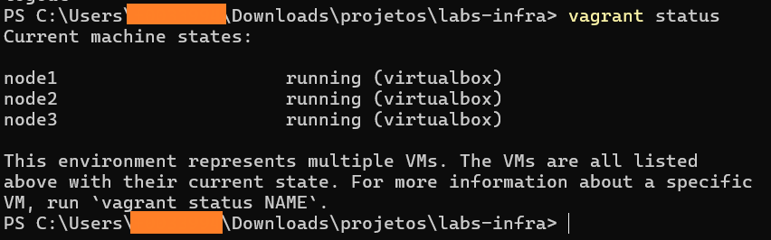

# Lab 00 — Ambiente

**Data:** 21/11/2026

## Objetivo

Montar um ambiente de laboratório reproduzível, com 3 VMs Linux que se comunicam numa rede privada,
criado e destruído com um único comando. Ele é a base de todos os labs seguintes.

## O que foi montado

| VM | Sistema | IP da rede dos labs | Memória | CPUs |
| --- | --- | --- | --- | --- |
| node1 | Rocky Linux 9.6 | 192.168.56.11 | 2 GB | 2 |
| node2 | Rocky Linux 9.6 | 192.168.56.12 | 2 GB | 2 |
| node3 | Rocky Linux 9.6 | 192.168.56.13 | 2 GB | 2 |

- **Virtualização:** VirtualBox 7
- **Orquestração das VMs:** Vagrant, com a imagem `bento/rockylinux-9`
- **Host:** notebook com Intel Core i3-1215U e 16 GB de RAM, Windows
- **Provisionamento:** um bloco `shell` no `Vagrantfile` grava os três nomes no `/etc/hosts` de cada VM,
  para que elas se encontrem pelo nome. O `grep -q` antes de cada linha evita duplicar a entrada
  quando o provisionamento roda de novo.

## Comandos usados

```powershell
vagrant up
vagrant status
vagrant ssh node1 -c "ping -c 2 node2; ping -c 2 node3"
vagrant ssh node2 -c "ping -c 2 node1; ping -c 2 node3"
vagrant ssh node1 -c "cat /etc/redhat-release; hostname -I; free -h"
```

A lista completa de comandos do Vagrant está em [cola-vagrant.md](cola-vagrant.md).

## Validação

- `vagrant status`: node1, node2 e node3 em `running (virtualbox)`.
- Ping entre todas as VMs pelo nome: **0% packet loss**, latência entre 2 e 7 ms.
- `node1`: Rocky Linux release 9.6 (Blue Onyx), 1,9 GiB de memória visível e 3 GiB de swap.

## O que aprendi

**Cada VM tem duas placas de rede, e cada uma tem um papel:**

| Placa | IP | Para que serve |
| --- | --- | --- |
| `eth0` (NAT) | 10.0.2.15 | Acesso à internet e conexão do `vagrant ssh`. **É o mesmo IP em todas as VMs**, então não serve para uma VM falar com a outra. |
| `eth1` (host-only) | 192.168.56.x | Rede privada onde as VMs conversam entre si e com o Windows. É a rede usada nos labs. |

Isso vai importar no lab 06: serviços como o k3s precisam ser configurados para usar a `eth1`
(`--node-ip` e `--flannel-iface=eth1`). Sem isso, eles escolhem a `eth0`, e os nós se registram
todos com o mesmo IP 10.0.2.15.

**Vagrant x Terraform x Ansible:** o Vagrant cria a máquina a partir de um arquivo, papel parecido
com o do Terraform, mas voltado para ambiente local e sem `plan` nem controle de drift. A
configuração do que roda dentro da VM é papel do Ansible (lab 03).

## Prints


